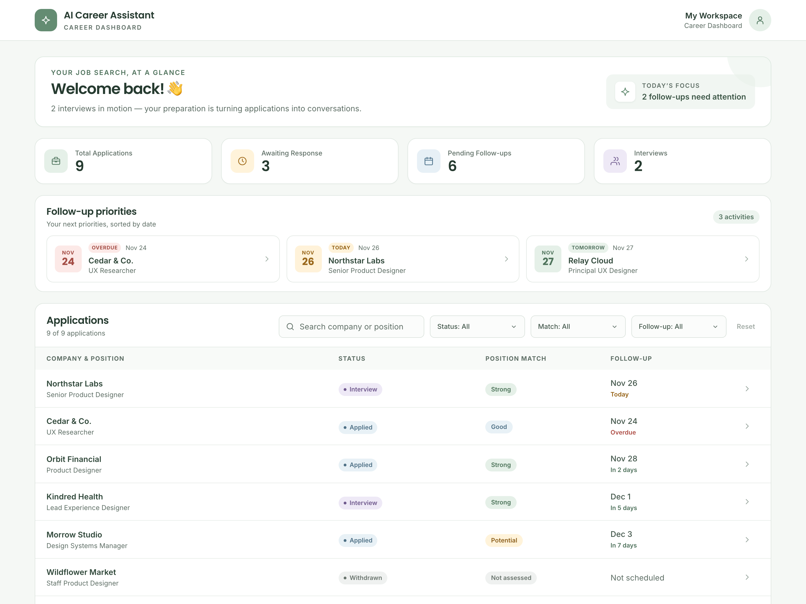
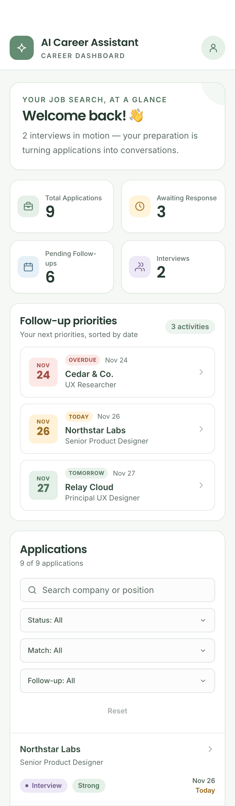
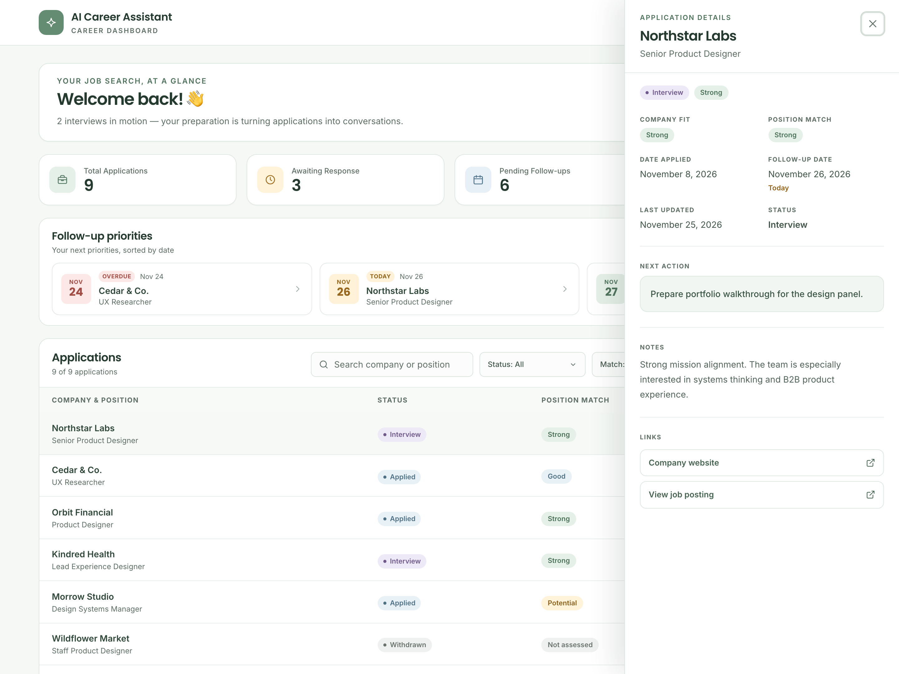

# AI Career Assistant

[](dashboard/package.json)
[](dashboard/package.json)
[](dashboard/package.json)
[](dashboard/package.json)
[](dashboard/.mise.toml)
[](.github/workflows/dashboard-qa.yml)

## Project Overview

Tracking job applications in a spreadsheet makes it easy to record updates, but finding overdue follow-ups and deciding what to do next still means scanning rows. **AI Career Assistant** brings those decisions into a searchable dashboard while keeping Google Sheets as the source of truth.

I developed this as an early-career Informatics graduate to practice turning a real workflow into a tested web application. The current dashboard is a local, read-only application. I used an AI coding assistant in the development workflow. The dashboard itself has no AI API integration.

[Try the credential-free demo](#quick-start) with the fictional records shown below.

## Key Features

- **Application statistics** show total applications, applications awaiting a response, interviews, and pending follow-ups.
- **Search and filters** help find applications by company or position and narrow the list by status, position match, or follow-up timing.
- **Follow-up priorities** show up to three of the earliest scheduled actions. Pending counts include overdue, current, and future dates for active applications. Closed applications keep their stored dates without urgency labels.
- **Responsive application views** include a desktop table, mobile cards, and a details panel with dates, ratings, notes, next actions, and available links.
- **Data and error handling** distinguishes missing and invalid dates, reports skipped rows, and offers a retry after a failed load.

## Dashboard Screenshots

All three screenshots use the same nine fictional records from the repository's fixture API.

### Desktop dashboard



### Mobile dashboard



### Application details



## My Role & AI-Assisted Development

- **Requirements and design.** I defined the dashboard scope, status and follow-up rules, and privacy requirements. I used Figma Make to explore the layout and reviewed how statistics, filters, and details worked on desktop and mobile.
- **Implementation review.** AI coding assistants helped draft code, tests, and documentation. I reviewed the proposals, asked how the changes worked, and checked them against the requirements before approving them.
- **Manual testing and bug validation.** I confirmed that tracker updates appeared after refresh and investigated a missing application date that turned out to be an empty source cell. Pre-merge QA also uncovered an incorrect overdue label on closed applications. I reviewed the fix and regression results before approving it.
- **Delivery.** I maintained the roadmap and QA records, reviewed feature branches and test results, and approved commits, pull requests, and merges.

## Technology Stack

| Area | Tools |
|---|---|
| Frontend | React, TypeScript, Vite, Tailwind CSS |
| Backend | Node.js HTTP server |
| Data and authentication | Google Sheets API, Google Auth Library |
| Testing and delivery | Node.js test runner, Playwright with Chromium, pnpm, GitHub Actions |

## System Architecture

```text
React dashboard → Vite development proxy → Node.js API → Google Sheets API
```

The reference backend validates spreadsheet rows, normalizes dates, and returns application records and aggregate skipped-row counts from `GET /api/applications`. React validates the response before rendering. This portfolio runs the same frontend against a local fixture API that supplies fictional records and requires no Google credentials.

## Quick Start

Use **Node.js 22** and **pnpm 10.34.3**. From the root of your local copy, install the dependencies:

```bash
cd dashboard
pnpm install --frozen-lockfile
```

From `dashboard/`, start the fictional fixture API in one terminal:

```bash
node tests/fixtures/startApplicationsApi.ts
```

In a second terminal, also in `dashboard/`, start Vite:

```bash
pnpm dev --host 127.0.0.1 --port 8443 --strictPort
```

Open [http://127.0.0.1:8443/](http://127.0.0.1:8443/) and leave both terminals running. The demo requires no Google account or spreadsheet.

### Preview the static portfolio build

From `dashboard/`, build and preview the portfolio mode without starting the fixture API:

```bash
pnpm build:portfolio
pnpm preview --mode portfolio --host 127.0.0.1 --port 4173 --strictPort
```

Open [http://127.0.0.1:4173/ai-career-assistant-portfolio/](http://127.0.0.1:4173/ai-career-assistant-portfolio/). This build loads fictional records in the browser and calculates their dates relative to the day you open it. The regular development command still uses the local API.

## Testing & Quality Assurance

Node.js tests cover calendar validation, row mapping, and API behavior with mocked Sheets requests. The Chromium suite exercises loading and retry, search and filters, application details, and status-aware follow-up labels on desktop and mobile. The QA record distinguishes automated checks from manual results.

Regression tests check that closed applications retain their saved follow-up dates without urgency labels. Manual acceptance also verified cross-device layout, the end-to-end refresh workflow, and isolation between the local data sources.

GitHub Actions runs TypeScript, Node.js unit tests, and Chromium end-to-end tests for dashboard changes on `main` and pull requests targeting it. The production build is checked separately. [Dashboard QA workflow](.github/workflows/dashboard-qa.yml) · [QA summary and test commands](docs/QA.md)

## Privacy & Data Isolation

The live integration was verified with separate read-only identities for the private tracker and fictional integration testing. This portfolio includes only repository fixtures and screenshots made from them. The reference backend and mocked tests show how Sheets integration works without disclosing operational setup or giving the demo access to a spreadsheet.

## Project Status & Roadmap

**Phase 1 was completed and accepted on November 27, 2026.** The local, read-only dashboard passed seven user-confirmed manual cases within the available scenarios. TypeScript, the build, 20 unit tests, and 21 Playwright E2E tests passed. [Acceptance evidence and limits](docs/QA.md#phase-1-acceptance)

The dashboard currently supports read-only tracking and visual follow-up reminders. The static fictional-data build is available for local preview. Hosting it, adding approved application updates, and exploring AI-assisted career features are future work.

## Documentation

- [Technical walkthrough](PROJECT_GUIDE.md) for the data flow, dashboard rules, and a presentation outline.
- [QA summary](docs/QA.md) for test commands, acceptance results, and coverage limits.
- [Dashboard QA workflow](.github/workflows/dashboard-qa.yml) for the automated CI configuration.
